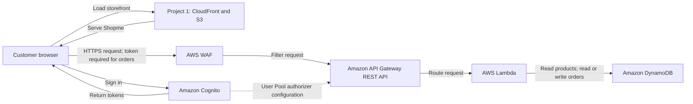

# Project 3: Serverless Order Processing

## Goal

Build a secure, scalable, cost-conscious serverless order-processing backend on AWS. It will demonstrate API design, authentication, NoSQL data modeling, and stateless compute that scales with demand.

## Project Requirements

- Reuse the Shopme storefront from Project 1; do not build a separate storefront for this project.
- Allow customers to browse products without signing in.
- Require Cognito authentication for order actions; product browsing is public.
- Never trust a customer ID or price supplied by the browser.
- Use Lambda to validate orders, calculate totals from trusted DynamoDB product data, and access the Products and Orders tables.
- Protect the API with AWS WAF.
- Keep the initial learning scope focused; payment processing and inventory management are not included yet.
- Make order creation idempotent: retrying the same checkout request must not create a duplicate order.

## Implementation Choices

- Infrastructure as Code: AWS CloudFormation templates written in YAML.
- Lambda language/runtime: Python 3.12.
- Stack organization: start with one CloudFormation stack for the initial implementation.

## Planned API

Initial endpoint proposal:

- `GET /products` — list active products and current prices from DynamoDB; public, no sign-in required.
- `POST /orders` — place an order; Cognito sign-in and an idempotency key are required. Retrying with the same key returns the original order.
- `GET /orders` — list the signed-in customer’s own orders; Cognito sign-in required.
- `GET /orders/{orderId}` — retrieve one of the signed-in customer’s orders; Cognito sign-in required.

The API and DynamoDB model will be refined before implementation.

## Initial DynamoDB Access Pattern

Each order is associated with the customer's verified Cognito `sub` and a unique `orderId`.

- Partition key: `CUSTOMER#<sub>`
- Sort key: `ORDER#<orderId>`
- `GET /orders` queries the authenticated customer's partition.
- `GET /orders/{orderId}` uses both keys to retrieve one order.
- Lambda gets the `sub` from the validated token, not from a customer ID supplied in the request.

### Product Catalog

The Products table is the trusted source for product details and current prices. Its base-table partition key supports looking up an individual product by ID, while `CatalogIndex` supports listing active products.

- Partition key: `productId` for looking up one product during order placement.
- Product attributes include `name`, `category`, `priceCents`, and `catalogStatus` (`ACTIVE` or `INACTIVE`).
- Global secondary index: `CatalogIndex`, with partition key `catalogStatus` and sort key `productId`.
- `GET /products` queries `CatalogIndex` for `catalogStatus = ACTIVE`.
- Lambda looks up submitted product IDs using the Products table partition key and stores purchase-time prices in the order.

### Order Item Example

A DynamoDB item represents one placed order. Lambda calculates the prices and total using trusted product data.

```json
{
  "PK": "CUSTOMER#<verified-cognito-sub>",
  "SK": "ORDER#<order-id>",
  "orderId": "<order-id>",
  "status": "PLACED",
  "createdAt": "<ISO-8601 timestamp>",
  "currency": "USD",
  "items": [
    {
      "productId": "sku-101",
      "quantity": 2,
      "unitPriceCents": 7999
    }
  ],
  "totalCents": 15998
}
```

## Architecture

The Shopme storefront remains hosted by Project 1. It calls the Project 3 API over HTTPS. Use a Regional API Gateway REST API so AWS WAF can be associated directly with its stage. API Gateway uses a Cognito User Pool authorizer for protected order routes; Lambda derives the customer identity from the verified token claims.



## AWS Services

- **Amazon API Gateway REST API:** exposes the order API; a Regional endpoint supports direct AWS WAF association.
- **AWS WAF:** filters common web attacks before requests reach the API.
- **Amazon Cognito:** authenticates customers; API Gateway validates their tokens.
- **AWS Lambda:** processes requests without managing servers.
- **Amazon DynamoDB:** stores the product catalog and customer orders.

## AWS Resource Map

| Resource | Project role |
|---|---|
| Regional API Gateway REST API | Defines the routes and sends each request to its Lambda function. |
| Cognito User Pool and app client | Signs customers in and issues tokens. |
| Cognito authorizer | Lets API Gateway validate tokens on order routes; `GET /products` remains public. |
| AWS WAF Web ACL and association | Filters requests at the API Gateway stage. |
| Products DynamoDB table | Stores trusted product details and prices; `CatalogIndex` lists active products. |
| Orders DynamoDB table | Stores customer orders, keyed by verified customer identity and order ID. |
| `ListProducts` Lambda | Queries active products through `CatalogIndex`. |
| `CreateOrder` Lambda | Reads product prices, calculates totals, and writes orders. |
| `ReadOrders` Lambda | Queries or retrieves orders belonging to the signed-in customer. |
| Lambda execution roles | Give each function only the DynamoDB actions it needs. |
| Lambda invoke permissions | Allow API Gateway to invoke the functions. |
| CloudWatch log groups | Store function logs for troubleshooting. |

## Resource Dependencies

CloudFormation builds the dependency graph from resource references. At a high level:

1. DynamoDB tables, Cognito resources, and Lambda execution roles are created.
2. Lambda functions are configured with their roles and table references.
3. API Gateway routes are connected to the functions; the authorizer protects the order routes.
4. An API Gateway stage is created, then WAF is associated with that stage.

This is a conceptual order, not a set of deployment commands.

## Security Notes

- Lambda derives the order owner from the verified Cognito identity, not from a request-supplied user ID.
- Lambda calculates order totals using trusted product data; it does not accept client-calculated prices.
- IAM permissions should follow least privilege.
- API CORS should allow only the intended storefront origin.

## Repository Structure

- `architecture/` — diagrams and architecture notes.
- `docs/` — API contract and design decisions.
- `templates/` — AWS infrastructure templates.
- `src/functions/orders/` — order-processing Lambda code.
- `tests/` — automated tests.
- `parameters/` — non-secret example configuration only.

## Deployment Status

- [ ] Requirements and API contract reviewed.
- [ ] Architecture and DynamoDB access patterns designed.
- [ ] Infrastructure and Lambda code implemented.
- [ ] Tests completed.
- [ ] AWS deployment verified.
- [ ] Resources deleted after the hands-on exercise.
