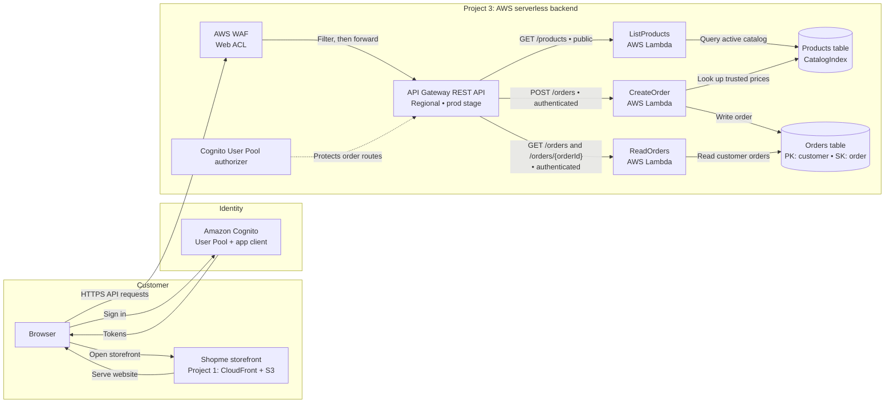

# Project 3 Architecture

This diagram shows the intended serverless order-processing design. Project 1
continues to host the Shopme storefront; Project 3 provides the API and backend.

## Implementation status

The deployed stack includes the Regional API Gateway, Cognito authorizer, WAF
association, DynamoDB tables, and product/order Lambda handlers. The public
product endpoint and Cognito Hosted UI sign-up have been tested. The Project 1
page has local changes for PKCE sign-in, authenticated checkout, and order
history; those changes still need to be uploaded and verified end to end. The
latest API Gateway error-response CORS changes also need to be deployed.
